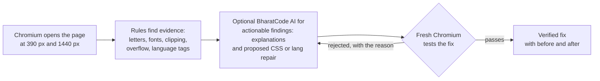

# AksharaCheck · अक्षर जाँच · ಅಕ್ಷರ ಪರಿಶೀಲನೆ

**Find the letters your website breaks.** AksharaCheck checks Hindi and Kannada text in Chromium, records visual and Unicode evidence, and optionally uses BharatCode to explain actionable findings and propose repairs. A proposed repair is marked *verified* only when a fresh Chromium check passes.

**Recorded result:** 9 of 9 actionable findings explained by BharatCode · 4 repairs verified in Chromium · public-page examples in Hindi and Kannada.

[](https://github.com/ashh-droid/AksharaCheck/actions/workflows/tests.yml)

[Website and text checker](https://ashh-droid.github.io/AksharaCheck/) · [BharatCode demo (verified repairs)](https://ashh-droid.github.io/AksharaCheck/samples/akshara-fixture-demo/report.html) · [Kannada public-page report](https://ashh-droid.github.io/AksharaCheck/samples/karnataka-varthe-kannada/report.html) · [Hindi public-page report](https://ashh-droid.github.io/AksharaCheck/samples/dd-news-hindi/report.html) · [BharatCode.txt](BharatCode.txt)

<p align="center"> </p>

### A three-minute tour for judges

1. **See real BharatCode output.** Open the [controlled demonstration report](https://ashh-droid.github.io/AksharaCheck/samples/akshara-fixture-demo/report.html), switch between English, हिंदी and ಕನ್ನಡ, and inspect the overflow finding's rejected and accepted repair attempts. The report contains the actual before/after Chromium screenshots.
2. **Inspect a Kannada-language observation.** Open the [Karnataka Varthe report](https://ashh-droid.github.io/AksharaCheck/samples/karnataka-varthe-kannada/report.html). It records 72 Kannada text elements inheriting the English language tag from one HTML ancestor, plus one unverified overflow warning. This is a browser measurement, not a screen-reader test or a change to the live government website.
3. **Compare a clean Hindi scan.** Open the [DD News report](https://ashh-droid.github.io/AksharaCheck/samples/dd-news-hindi/report.html) to see zero findings at the tested widths, the 162 phone and 213 desktop sampled-text counts, and page screenshots. Then try the [in-browser text checker](https://ashh-droid.github.io/AksharaCheck/#try).

**The public GitHub Pages site is a static showcase and text checker, not a live URL scanner.** Run the Python/Chromium scanner locally using the instructions below.

## The problem

A page can look fine during a quick visual review but contain malformed Indic character sequences, clipped marks, phone-width overflow or incorrect language metadata. For example, a Kannada passage tagged as English may be pronounced incorrectly by assistive technology. AksharaCheck records browser evidence so developers can investigate and fix these issues without relying on model guesses.

## How it works



1. **Chromium measures.** At phone (390 px) and desktop (1440 px) widths, the scanner records sampled text, character sequences, language tags, font evidence, geometry and screenshots. Browser rules produce the findings; the model does not invent them.
2. **BharatCode explains (optional).** With `--ai`, BharatCode's `qwen-3.8-27b` receives actionable Fix/Check findings, explains them in English, provides Hindi/Kannada summaries and may propose a restricted CSS or `lang` repair. Informational notes remain browser-only.
3. **Chromium verifies.** Proposed repairs are tested on a fresh page. A repair earns *verified* status only if the original issue clears and visibility/size checks pass. Rejected attempts and reasons remain in the report, with at most three tries. The scanner never changes the target website.

## Results so far

| Recorded scan | What it shows |
| --- | --- |
| [BharatCode demo report](https://ashh-droid.github.io/AksharaCheck/samples/akshara-fixture-demo/report.html) (a test page with planted bugs, not a real website) | 3 problems to fix, 6 to check, 2 notes. BharatCode explained 9 of 9 findings in three languages; Chromium verified 4 repairs, including one that passed only after a first suggestion was rejected. |
| [Karnataka Varthe (Kannada)](https://ashh-droid.github.io/AksharaCheck/samples/karnataka-varthe-kannada/report.html), 31 Oct 2026 | **0 confirmed Fix-level errors.** The scan recorded 72 Kannada text observations inheriting `lang="en"` from the same HTML ancestor, one possible phone overflow requiring review, and 13 informational font-name observations. Correct language metadata is a plausible remedy, but no change to the live site or screen-reader behavior was verified. |
| [DD News (Hindi)](https://ashh-droid.github.io/AksharaCheck/samples/dd-news-hindi/report.html), 31 Oct 2026 | No findings at either width. Chromium checked 162 text elements on the phone layout and 213 on desktop, and the report shows both page screenshots. |

These are dated, scoped Chromium snapshots, not site-wide accessibility certifications. The controlled fixture includes actual BharatCode calls and verified repairs; the real public-page reports are browser-only and include reviewed context. An older [Hindi Wikipedia report](https://ashh-droid.github.io/AksharaCheck/samples/hindi-wikipedia/report.html) remains available as an archive, but is not part of the final showcase.

**Reducing false positives is part of the result.** Earlier DD News scans recorded 63 informational typography notes. After narrowing normal Hindi line-spacing and expected Arial-to-Nirmala UI fallback rules, a fresh scan recorded zero findings at those two widths. That improved the scanner; it did not fix or certify DD News.

## What it checks

| Check | Level | What it means |
| --- | --- | --- |
| Broken letters | Fix | A vowel sign, nukta or virama with no letter to attach to |
| Web font did not load | Fix | A font file the page asked for failed to download |
| Wrong language tag | Check | Text in Devanagari or Kannada script tagged as another language |
| Two languages without labels | Check | Hindi and Kannada in one element under one language tag |
| Old non-Unicode font | Check | Latin letters shown through a legacy font such as KrutiDev |
| Text runs off the screen | Check | A line wider than its box at phone width |
| Letters may be cut off | Check | Text taller than the box that shows it |
| Font family names differ | Note | The CSS family name differs from Chromium's reported internal font name; this can be intentional |
| Unusually tight line spacing | Note | Multiple text lines use unusually little vertical separation; review visually |

## Run a browser-only scan (no BharatCode key needed)

You need Python 3.10 or newer and permission to scan the selected public page. On Windows Command Prompt:

```cmd
git clone https://github.com/ashh-droid/AksharaCheck.git
cd AksharaCheck
py -3 -m venv .venv
.venv\Scripts\python.exe -m pip install -e ".[test]"
.venv\Scripts\python.exe -m playwright install chromium
.venv\Scripts\python.exe -m aksharacheck scan https://hi.wikipedia.org/ --lang both --output output\first-scan
start output\first-scan\report.html
```

On macOS or Linux, use `python3 -m venv .venv`, `.venv/bin/python` in place of `.venv\Scripts\python.exe`, and `open` or `xdg-open` for the report.

The command above runs the browser checks and writes `report.html`, `report.md` and `report.json`. **No account or API key is needed.** Optionally add `--ai` to request BharatCode explanations and repair verification for actionable findings; this requires a valid `BHARATCODE_API_KEY` and may incur model usage. Use `--fail-on error` in CI if you want a nonzero exit code when a Fix-level finding is recorded.

### Reproduce the BharatCode demonstration (optional)

**For judges:** open the [published 9/9 demo report](https://ashh-droid.github.io/AksharaCheck/samples/akshara-fixture-demo/report.html). It already includes genuine BharatCode outputs, four Chromium-verified repairs and rejected-attempt evidence; **you do not need an API key to view it**.

To run the model-assisted fixture again yourself (requires a BharatCode key and new API calls after detector changes):

```cmd
.venv\Scripts\python.exe scripts\run_ai_demo.py --max-findings 9
start output\ai-demo\report.html
```

The script serves `fixtures/toota-akshar`, scans it and runs the BharatCode/Chromium loop. The key is entered at a hidden prompt and is not saved. Successful findings can be checkpointed and resumed **only when the scanner, AI client and fixture have not changed**; older checkpoints are invalidated after relevant code changes. See [development instructions](docs/DEVELOPMENT.md) for troubleshooting.

### Run the local web app

Start the Python API in **one terminal**, from the repository root:

```cmd
.venv\Scripts\python.exe -m aksharacheck serve --port 8000
```

In a **second terminal**, from the same repository root:

```cmd
cd web
npm install
npm run dev
```

Open http://127.0.0.1:5173. The local interface can request scans through the running Python server; GitHub Pages hosts only the static showcase and in-browser text checker.

## Project structure

| Path | Contents |
| --- | --- |
| `aksharacheck/browser.py` | Playwright scanner: phone and desktop widths, fonts, screenshots |
| `aksharacheck/detectors.py` | The rendering rules |
| `aksharacheck/ai.py` | BharatCode client, CSS whitelist and the Chromium verification loop |
| `aksharacheck/report.py` | HTML, Markdown and JSON reports |
| `aksharacheck/api.py`, `cli.py` | FastAPI server and command line |
| `web/` | React and Vite website, including the in-browser text checker |
| `scripts/` | BharatCode demo, report publishing and visual QA |
| `fixtures/toota-akshar/` | Test page with planted rendering bugs |
| `tests/` | Automated unit and real-browser checks of the website and reports |

## Testing

```cmd
.venv\Scripts\python.exe -m pytest -q
```

GitHub Actions runs the full suite on every push, including Chromium checks of the website at nine screen widths and of a generated report at five. `scripts\check_report_ui.py <report.html>` checks any report the same way.

## Security and privacy

- The BharatCode key stays in a server-side environment variable. It is never sent to the browser, written to the checkpoint or printed.
- Page content is treated as untrusted. The model can only return whitelisted CSS properties and a `lang` value; URLs, imports and selectors are rejected.
- The scanner refuses local and private network addresses unless `--allow-local` is passed on the command line for a trusted test page.
- Reports include text samples from the scanned page, so scan public pages only.

## Limitations

AksharaCheck samples visible page text in Chromium at the recorded widths and captures; it is **not** a complete WCAG accessibility audit or a guarantee about every page, device, browser or screen reader. It does not review PDFs, images, native apps, login-only pages, spelling or translation. Check/Note findings need human review of the underlying element and screenshot. Repairs are tested on temporary browser copies only, never applied to the scanned website.

## Development disclosure

AI tools including ChatGPT and Claude assisted with planning, coding, debugging, design and documentation. The team reviewed and tested the work; the test suite and the Chromium checks are reproducible. The nine-finding demonstration used real BharatCode API responses and fresh browser checks, and the report marks which explanations were reused from an earlier run.

The report fonts are Anek Latin, Anek Devanagari and Anek Kannada, under the SIL Open Font License (`aksharacheck/assets/OFL.txt`).
