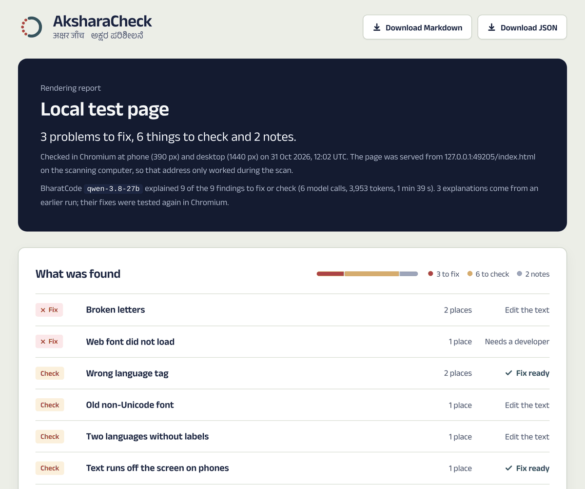
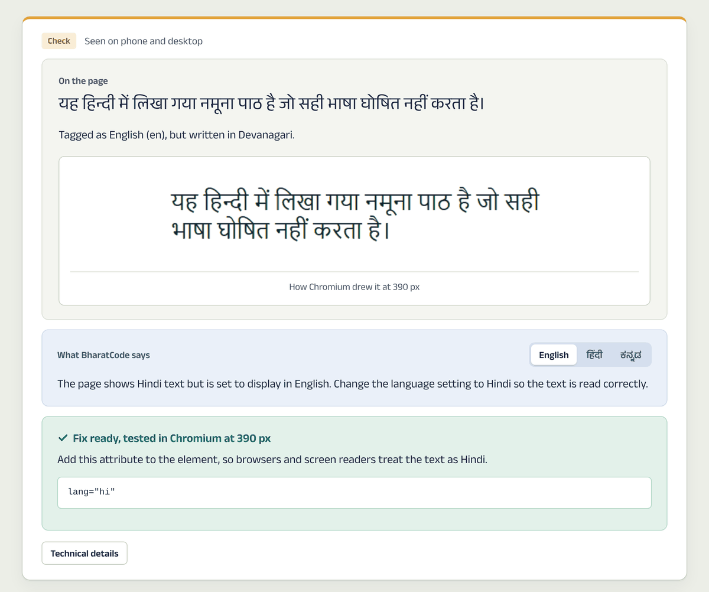
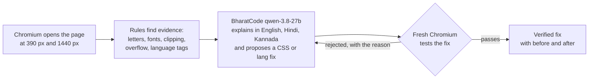

# AksharaCheck · अक्षर जाँच · ಅಕ್ಷರ ಪರಿಶೀಲನೆ

**Find the letters your website breaks.** AksharaCheck opens a page in a real browser, finds Hindi and Kannada text that comes out broken, and asks BharatCode to explain each problem in English, Hindi and Kannada and draft a fix. A fix counts only when Chromium agrees.

[](https://github.com/ashh-droid/AksharaCheck/actions/workflows/tests.yml)

[Website](https://ashh-droid.github.io/AksharaCheck/) · [BharatCode demo report](https://ashh-droid.github.io/AksharaCheck/samples/akshara-fixture-demo/report.html) · [Hindi Wikipedia report](https://ashh-droid.github.io/AksharaCheck/samples/hindi-wikipedia/report.html) · [BharatCode.txt](BharatCode.txt)

<p align="center"> </p>

## The problem

A page can look fine to an English-speaking developer and still be broken for Hindi and Kannada readers. A vowel sign typed after a space floats on a dotted circle. A fixed-height box cuts off the marks above the line. Hindi tagged as English is read aloud in an English voice. These bugs are rarely caught, because the people who would notice them are not the people testing the site.

## How it works



1. **The browser finds the problems.** Every finding comes from measurements in Chromium: which font drew each letter, character sequences, box and text sizes, and language tags. The model never creates a finding.
2. **BharatCode explains and proposes.** For each finding, `qwen-3.8-27b` (BharatCode Responses API, streaming) writes a plain explanation in English, a one-line summary in Hindi and in Kannada, and a repair limited to a whitelist of CSS properties or a `lang` attribute. Page text is sent as untrusted data, never as instructions.
3. **Chromium decides.** The repair is applied in a fresh browser. It is marked verified only if the original problem is gone and the text is still visible, full size and on screen. A rejected repair goes back to the model with the browser's reason, up to three tries, and every attempt stays in the report.

## Results so far

| Recorded scan | What it shows |
| --- | --- |
| [BharatCode demo report](https://ashh-droid.github.io/AksharaCheck/samples/akshara-fixture-demo/report.html) (a test page with planted bugs, not a real website) | 3 problems to fix, 6 to check, 2 notes. BharatCode explained 9 of 9 findings in three languages; Chromium verified 4 repairs, including one that passed only after a first suggestion was rejected. |
| [Hindi Wikipedia](https://ashh-droid.github.io/AksharaCheck/samples/hindi-wikipedia/report.html), 31 Oct 2026 | 0 problems, 0 to check, 3 notes (font fallback and line spacing observations). Browser checks only, no model calls. |

Both reports are published exactly as AksharaCheck wrote them. Open them to see the screenshots, the character codes, every repair attempt and the Markdown and JSON downloads.

## What it checks

| Check | Level | What it means |
| --- | --- | --- |
| Broken letters | Fix | A vowel sign, nukta or virama with no letter to attach to |
| Web font did not load | Fix | A font file the page asked for failed to download |
| Wrong language tag | Check | Text in Devanagari or Kannada script tagged as another language |
| Two languages without labels | Check | Hindi and Kannada in one element under one language tag |
| Old non-Unicode font | Check | Latin letters shown through a legacy font such as KrutiDev |
| Text runs off the screen | Check | A line wider than its box at phone width |
| Letters may be cut off | Check | Text taller than the box that shows it |
| A different font was used | Note | Chromium drew the text with a fallback font |
| Tight line spacing | Note | Lines too close for Indic marks above and below |

## Try it

You need Python 3.10 or newer. On Windows Command Prompt:

```cmd
git clone https://github.com/ashh-droid/AksharaCheck.git
cd AksharaCheck
py -3 -m venv .venv
.venv\Scripts\python.exe -m pip install -e ".[test]"
.venv\Scripts\python.exe -m playwright install chromium
.venv\Scripts\python.exe -m aksharacheck scan https://hi.wikipedia.org/ --lang both --output output\first-scan
start output\first-scan\report.html
```

On macOS or Linux, use `python3 -m venv .venv`, `.venv/bin/python` in place of `.venv\Scripts\python.exe`, and `open` or `xdg-open` for the report.

The browser scan needs no API key. Add `--ai` to ask BharatCode about the findings, with the key in the `BHARATCODE_API_KEY` environment variable. Add `--fail-on error` to make the command fail when a problem to fix is found, for use in automated builds.

### Run the BharatCode demo

```cmd
.venv\Scripts\python.exe scripts\run_ai_demo.py --max-findings 9
start output\ai-demo\report.html
```

The script serves the test page in `fixtures/toota-akshar`, scans it and runs the full BharatCode and Chromium loop. It asks for your key at a hidden prompt and never saves it. Completed findings are checkpointed, so if BharatCode is busy you can run the same command again and only the remaining findings are sent. [docs/DEVELOPMENT.md](docs/DEVELOPMENT.md) covers troubleshooting.

### Run the web app locally

```cmd
.venv\Scripts\python.exe -m aksharacheck serve --port 8000
cd web
npm install
npm run dev
```

Open http://127.0.0.1:5173 to scan from the browser. The public website on GitHub Pages is static: it hosts the recorded reports and an in-browser Hindi and Kannada text checker, but it cannot run Chromium, so live scans need the local server.

## Project structure

| Path | Contents |
| --- | --- |
| `aksharacheck/browser.py` | Playwright scanner: phone and desktop widths, fonts, screenshots |
| `aksharacheck/detectors.py` | The rendering rules |
| `aksharacheck/ai.py` | BharatCode client, CSS whitelist and the Chromium verification loop |
| `aksharacheck/report.py` | HTML, Markdown and JSON reports |
| `aksharacheck/api.py`, `cli.py` | FastAPI server and command line |
| `web/` | React and Vite website, including the in-browser text checker |
| `scripts/` | BharatCode demo, report publishing and visual QA |
| `fixtures/toota-akshar/` | Test page with planted rendering bugs |
| `tests/` | 138 tests, including real-browser checks of the website and reports |

## Testing

```cmd
.venv\Scripts\python.exe -m pytest -q
```

GitHub Actions runs the full suite on every push, including Chromium checks of the website at nine screen widths and of a generated report at five. `scripts\check_report_ui.py <report.html>` checks any report the same way.

## Security and privacy

- The BharatCode key stays in a server-side environment variable. It is never sent to the browser, written to the checkpoint or printed.
- Page content is treated as untrusted. The model can only return whitelisted CSS properties and a `lang` value; URLs, imports and selectors are rejected.
- The scanner refuses local and private network addresses unless `--allow-local` is passed on the command line for a trusted test page.
- Reports include text samples from the scanned page, so scan public pages only.

## Limitations

AksharaCheck checks text rendered in Chromium on public pages. It does not check PDFs, images, apps, pages behind a login, spelling or translation, and it is not a full accessibility audit. Checks marked Check and Note need a person to confirm them with the screenshot. Repairs are proposals verified on a copy of the page in a browser; they are never applied to your site.

## Development disclosure

AI tools including ChatGPT and Claude assisted with planning, coding, debugging, design and documentation. The team reviewed and tested the work; the test suite and the Chromium checks are reproducible. The nine-finding demonstration used real BharatCode API responses and fresh browser checks, and the report marks which explanations were reused from an earlier run.

The report fonts are Anek Latin, Anek Devanagari and Anek Kannada, under the SIL Open Font License (`aksharacheck/assets/OFL.txt`).
